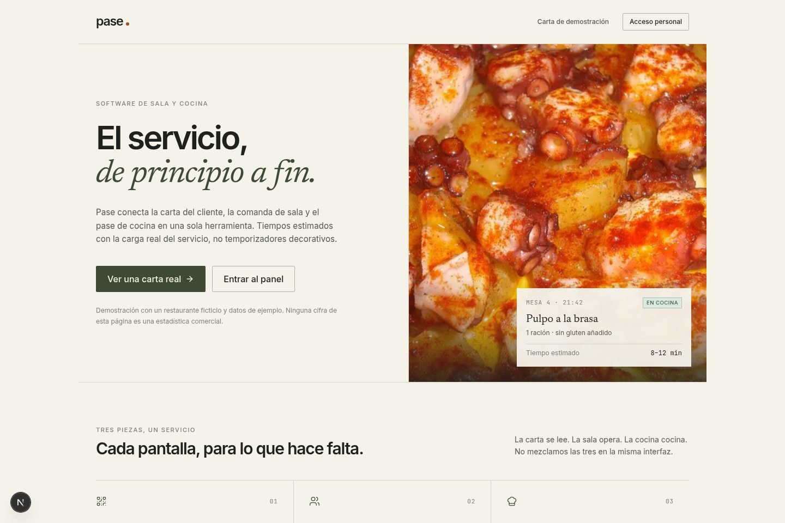
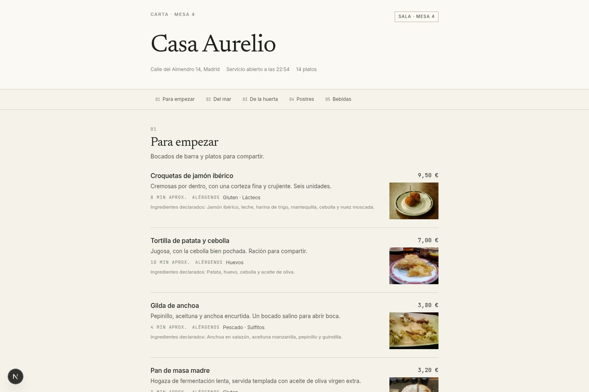
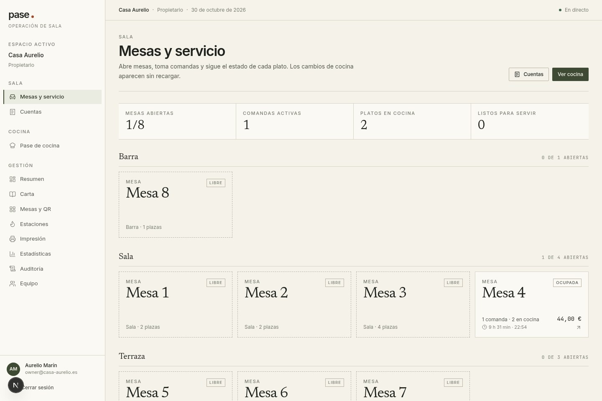
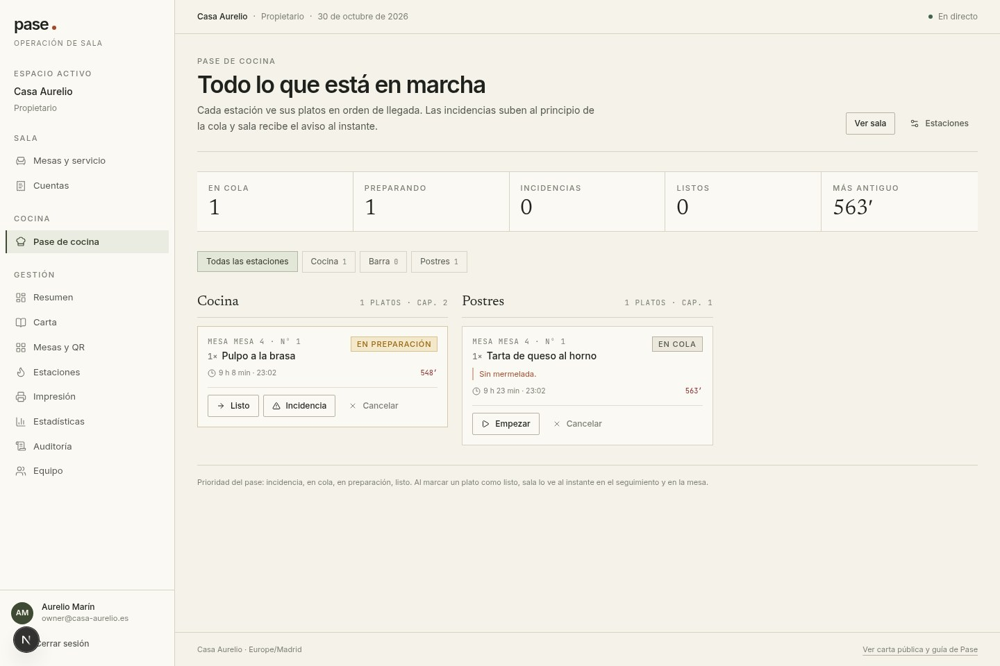
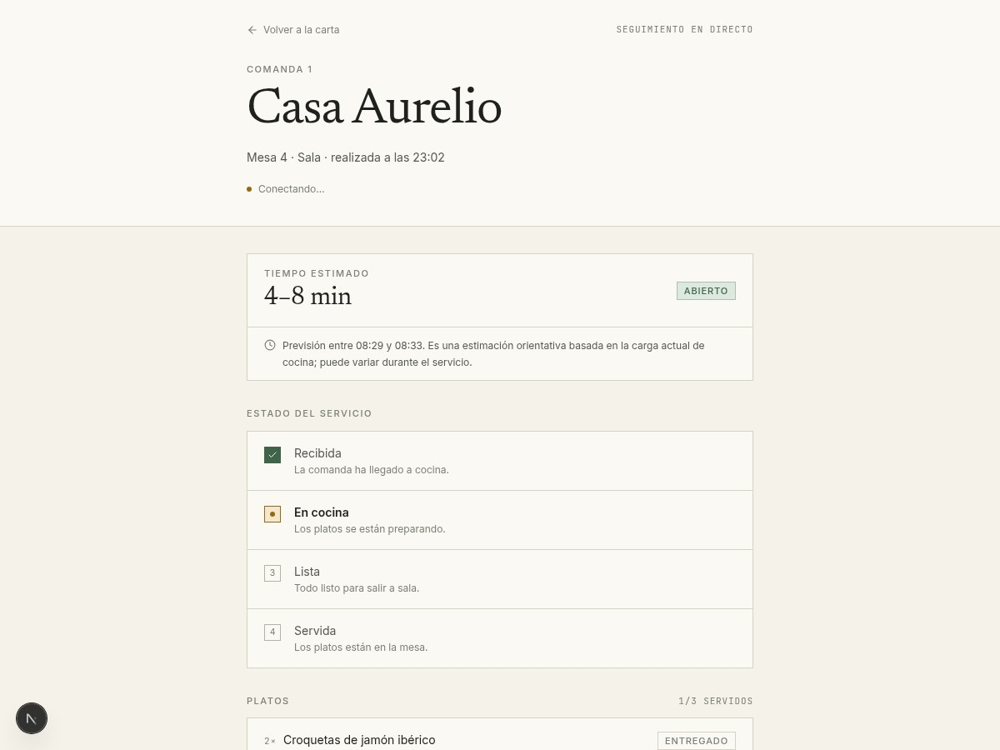
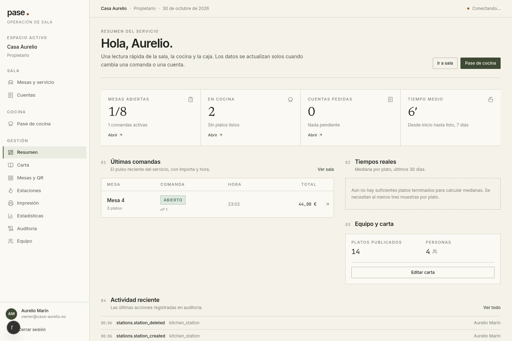
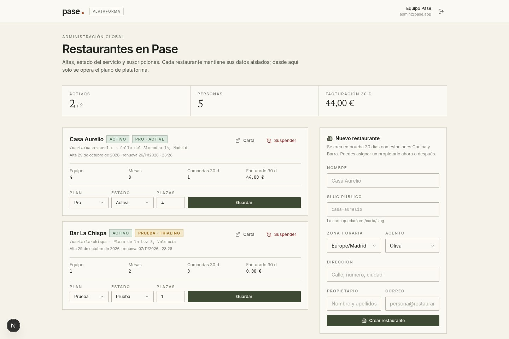
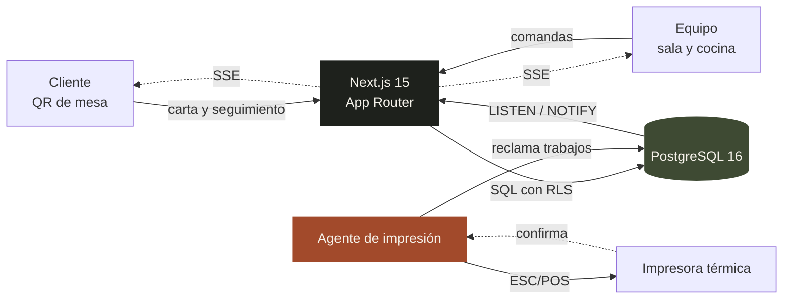

<p align="center">
  
</p>

<h1 align="center">Pase</h1>

<p align="center">
  <strong>La sala y la cocina, en el mismo pase.</strong><br />
  Carta QR, comandas, pase de cocina, seguimiento del cliente e impresión térmica<br />
  en una sola herramienta para restaurantes, bares y hoteles.
</p>

<p align="center">
  
  
  
  
  
  
  
</p>

<p align="center">
  <sub>MVP funcional · PostgreSQL local con RLS · sin dependencias cloud para arrancar</sub>
</p>

---

## La idea

En muchos bares la comanda sigue siendo un papel que corre de la mesa a la cocina. Pase lleva ese recorrido a una pantalla compartida: el cliente consulta la carta desde el QR de su mesa, sala registra la comanda, cocina trabaja por estaciones y el cliente sigue el estado de sus platos sin preguntar.

No es un TPV completo ni un sustituto del criterio del equipo. Es la capa que conecta sala, cocina y cliente con información actualizada en tiempo real.

> **Qué cambia:** menos desplazamientos, menos tickets perdidos y una estimación de tiempo que se explica sola: capacidad de cada estación, cola real y platos ya en marcha.

<p align="center">
  <sub>
    <a href="#la-idea">La idea</a> ·
    <a href="#qué-incluye">Qué incluye</a> ·
    <a href="#capturas">Capturas</a> ·
    <a href="#cómo-funciona">Cómo funciona</a> ·
    <a href="#arranque-rápido">Arranque</a> ·
    <a href="#pruebas">Pruebas</a> ·
    <a href="#decisiones-de-arquitectura">Arquitectura</a>
  </sub>
</p>

## Qué incluye

| Módulo | Qué hace |
| --- | --- |
| **Carta digital** | Carta pública por restaurante y mesa, con precios, alérgenos, disponibilidad y fotografías. Sin instalar nada. |
| **Sala** | Mapa de mesas, apertura de servicio, comandas con notas, cuentas y seguimiento de lo que falta por salir. |
| **Pase de cocina** | Una pantalla por estación, ordenada por antigüedad. Empezar, listo, incidencia, entrega y reimpresión. |
| **Seguimiento** | El cliente abre un enlace privado y ve el estado de su comanda y un intervalo de tiempo estimado. |
| **Administración** | CRUD de carta, mesas, QR, estaciones, impresoras, equipo, estadísticas y auditoría. |
| **Plataforma** | Alta de restaurantes, suspensión y gestión de suscripciones desde un panel de superadmin. |
| **Impresión** | Cola persistente y agente local para impresoras térmicas ESC/POS por red o USB. |

## Capturas

<table>
  <tr>
    <td width="50%" align="center">
      
      <br />
      <sub><b>Carta pública</b> · el cliente escanea el QR de su mesa</sub>
    </td>
    <td width="50%" align="center">
      
      <br />
      <sub><b>Sala</b> · mesas, comandas activas y cuentas</sub>
    </td>
  </tr>
  <tr>
    <td width="50%" align="center">
      
      <br />
      <sub><b>Cocina</b> · pase por estación y carga real</sub>
    </td>
    <td width="50%" align="center">
      
      <br />
      <sub><b>Seguimiento</b> · estado y tiempo estimado para el cliente</sub>
    </td>
  </tr>
  <tr>
    <td width="50%" align="center">
      
      <br />
      <sub><b>Resumen</b> · una lectura rápida de sala, cocina y caja</sub>
    </td>
    <td width="50%" align="center">
      
      <br />
      <sub><b>Plataforma</b> · alta y estado de restaurantes</sub>
    </td>
  </tr>
</table>

## Cómo funciona



- **Una sola base de datos, varias capas de acceso.** Las consultas de staff fijan `app.user_id` en la transacción; PostgreSQL aplica RLS por restaurante. La carta y el seguimiento pasan por funciones `SECURITY DEFINER` mínimas.
- **Tiempo real sin WebSocket.** `LISTEN/NOTIFY` alimenta dos flujos SSE: uno para el personal y otro por token de seguimiento.
- **Impresión desacoplada.** La aplicación solo encola; el agente reclama trabajos, imprime y confirma. Si la impresora falla, hay reintentos con espera creciente.
- **Idempotencia de verdad.** Las comandas y sus líneas llevan claves de idempotencia para que un doble envío no duplique platos ni tickets.

## Arranque rápido

Requisitos: **Node.js 20.11+**, **Docker con Compose** y **Chromium** para las pruebas E2E.

```bash
# Clona el repositorio y entra en la carpeta
cp .env.example .env.local
npm install
npm run db:up
npm run db:migrate
npm run db:seed
npm run dev
```

La aplicación queda en **http://localhost:3010**. PostgreSQL se publica solo en `127.0.0.1:5435`.

> Si tu usuario no está en el grupo `docker`, ejecuta los comandos de Compose con `sg docker -c "..."`.

### Cuentas de demostración

Contraseña común: `PaseDemo2026!`

| Correo | Rol | Restaurante |
| --- | --- | --- |
| `owner@casa-aurelio.es` | Propietario | Casa Aurelio |
| `encargada@casa-aurelio.es` | Encargada | Casa Aurelio |
| `sala@casa-aurelio.es` | Sala | Casa Aurelio |
| `cocina@casa-aurelio.es` | Cocina | Casa Aurelio |
| `owner@lachispa.es` | Propietario | La Chispa |
| `admin@pase.app` | Superadmin | Plataforma |

<details>
<summary><b>Rutas principales</b></summary>

<br />

| Ruta | Uso |
| --- | --- |
| `/carta/<slug>?mesa=<token>` | Carta pública de la mesa |
| `/seguimiento/<token>` | Seguimiento privado de una comanda |
| `/admin` | Resumen del servicio |
| `/admin/carta` | Categorías, platos, precios y alérgenos |
| `/admin/mesas` | Mesas, zonas y QR en SVG/PNG |
| `/admin/estaciones` | Partidas de cocina y capacidad |
| `/admin/impresion` | Impresoras, agentes y cola de trabajos |
| `/admin/estadisticas` | Actividad y tiempos reales |
| `/admin/auditoria` | Registro de acciones |
| `/admin/equipo` | Altas, roles y bajas del personal |
| `/plataforma` | Alta y suspensión de restaurantes |
| `/sala`, `/sala/mesa/<id>` | Mapa de mesas y comandas |
| `/cocina` | Pase de cocina por estación |
| `/sala/cuentas` | Solicitudes de cuenta |

</details>

## Impresión térmica

El navegador nunca habla directamente con la impresora. La cola vive en PostgreSQL y un agente local reclama trabajos con un token propio; así la impresora puede quedarse en la red del restaurante sin abrir puertos a internet.

```bash
# Un solo ciclo, útil para probar
npm run print:agent -- --token pase_dev_agent_casa_aurelio --once

# Agente permanente, consultando cada 3 segundos
PRINT_AGENT_TOKEN=pase_dev_agent_casa_aurelio npm run print:agent
```

| Tipo | Comportamiento |
| --- | --- |
| `test` | Escribe un ticket de texto en `agent/out/`. Es el modo de las impresoras demo. |
| `network` | Envía ESC/POS por TCP al destino `host:puerto` (habitualmente `9100`). |
| `usb_agent` | Escribe ESC/POS en la ruta del dispositivo indicada. |

Los tickets de prueba se generan desde `/admin/impresion`. Los tokens de agente se muestran una sola vez al crearlos; en la base de datos solo queda su hash SHA-256.

## Pruebas

```bash
npm run typecheck        # TypeScript estricto
npm test                 # 29 pruebas de unidad
npm run test:integration # 11 pruebas contra PostgreSQL real
npm run test:e2e         # 4 recorridos de Playwright
npm run build            # compilación de producción
```

Las pruebas cubren el estimador de tiempos, las transiciones de estado, las capacidades por rol, los precios, la API pública, RLS, el alta de personal, el agente de impresión y los flujos principales de la interfaz.

## Decisiones de arquitectura

<details>
<summary><b>PostgreSQL local en vez de Supabase</b></summary>

<br />

El proyecto se ha construido para ser reproducible y verificable sin credenciales externas. La seguridad no se simula: RLS está forzada en todas las tablas de negocio y las operaciones públicas pasan por funciones `SECURITY DEFINER` mínimas.

La migración a Supabase consiste en reapuntar `DATABASE_URL` y `DATABASE_APP_URL`, trasladar las migraciones y sustituir la sesión propia por Supabase Auth. El esquema y las políticas ya están preparados.

</details>

<details>
<summary><b>Sesión propia y aislamiento por restaurante</b></summary>

<br />

Cookie opaca `pase_session`, guardada como HMAC-SHA256 en `auth_sessions`, con caducidad de 12 horas. El token nunca se guarda en claro.

Cada consulta de staff fija `app.user_id` dentro de la transacción; las políticas RLS comprueban la pertenencia. El restaurante activo se guarda en `pase_restaurant` y se valida contra las pertenencias.

</details>

<details>
<summary><b>Tiempos explicables</b></summary>

<br />

El estimador es puro y testeable: capacidad por estación, cola de otras mesas y tiempo restante de lo que ya está en marcha. No promete precisión: muestra un intervalo, el momento estimado y un aviso.

</details>

## Estructura

```text
.
├── app/
│   ├── (public)/          # carta, login y seguimiento
│   ├── (staff)/           # sala, cocina y administración
│   ├── api/               # QR, SSE y solicitud de cuenta
│   └── plataforma/        # panel de superadmin
├── components/            # shell, staff, admin, platform, public y ui
├── features/              # dominio: orders, menu, tables, printing, staff...
├── db/
│   ├── migrations/        # esquema, RLS, API y agente
│   └── seed.sql           # datos de demostración
├── agent/                 # agente local de impresión
├── lib/                   # db, sesión, mensajes, dinero, tiempo, SSE
├── tests/                 # unit, integration y e2e
└── docs/screenshots/      # capturas de este README
```

## Estado

Cubierto: carta, comandas, cocina, cuentas, seguimiento, estimación, QR, CRUD de carta/mesas/estaciones/equipo, impresión con agente, panel de plataforma, auditoría, estadísticas y pruebas.

Pendiente para producción: cobro online real, almacenamiento de imágenes en un servicio externo, SSE multiinstancia, autenticación de dos factores y despliegue con TLS. La impresión ESC/POS translitera acentos porque cada fabricante usa una página de códigos distinta.

---

<p align="center">
  <sub>
    Fotografías de demostración procedentes de Wikimedia Commons ·
    <a href="public/demo/CREDITS.md">créditos y licencias</a>
  </sub>
</p>

<p align="center">
  <sub>Hecho con Next.js, PostgreSQL y bastante servicio de sala.</sub>
</p>
